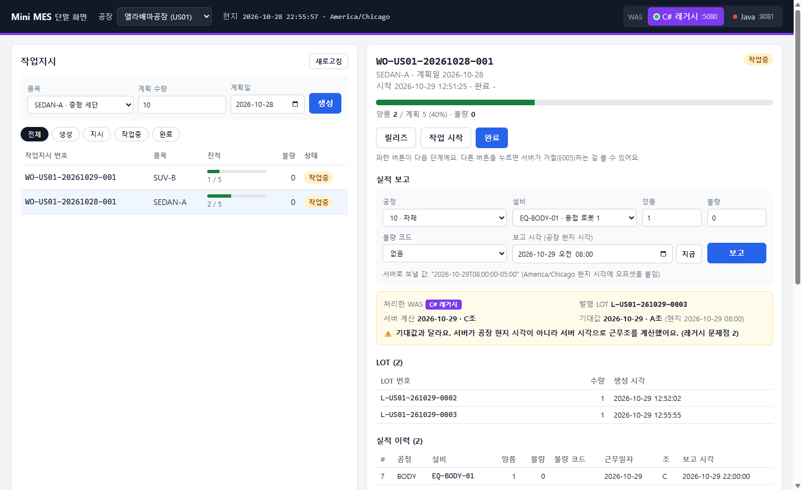

# Mini MES: C# → Java 전환 프로젝트

완성차 공장의 MES(제조실행시스템)를 작게 만들고, **C# 레거시 WAS를 Java(Spring Boot)로 전환**하는 과정을 직접 해 보는 학습 프로젝트입니다.
같은 단말 화면이 두 WAS에서 똑같이 동작하는지 눈으로 확인하면서 진행합니다.



> 앨라배마 공장에서 현지 시각 08:00에 보고한 실적을 레거시 WAS가 C조로 계산한 모습입니다. 기대값은 A조입니다. ([레거시 문제점 2](docs/01-legacy.md#근무조를-서버-시간으로-계산하는-문제))

## 왜 만드나

운영 중인 C# 서비스를 Java로 옮기는 일은 새 서비스를 만드는 일과 어려운 지점이 다릅니다.
현장 단말과 설비는 지금의 응답 형식에 맞춰져 있고, 공장은 전환하는 동안에도 돌아갑니다. 그래서 새 코드를 잘 짜는 것보다 **지금 돌아가는 것을 깨지 않고 바꾸는 것**이 더 어렵다고 봤습니다.

이 프로젝트는 완성차 MES 백엔드 직무가 하는 일 중 하나인 개발 언어 전환(C# → Java)을, 그 조건 그대로 작게 해 보려고 만들었습니다. 직접 답을 찾고 싶은 질문은 세 가지입니다.

1. **무엇을 지켜야 하나**: 단말이 의존하는 응답 계약을 지키면서 WAS만 바꿀 수 있는가
2. **같다는 걸 어떻게 보여 주나**: 옮긴 코드가 레거시와 똑같이 동작한다는 것을 무엇으로 확인하는가
3. **언제, 어떻게 고치나**: 레거시에 숨어 있던 문제를 지금 동작을 깨지 않고 어떻게 고치는가

실무 레거시 코드를 가져올 수는 없어서, 레거시에서 흔히 보이는 구조와 문제를 일부러 넣은 C# 서비스를 먼저 만들고 그것을 전환합니다.
직무의 다른 업무도 같은 프로젝트 안에서 단계별로 다룹니다.

| 직무에서 하는 일 | 이 프로젝트에서 하는 것 |
|---|---|
| 기존 서비스의 개발 언어 전환 (C# → Java) | C# 레거시 API를 같은 API 계약으로 Spring Boot에 재구현 |
| MSA, 3-Tier 아키텍처 반영 | WEB(nginx·화면) – WAS – DB 3-tier 구성, WAS 내부 계층(Controller / Service / Mapper) 분리, 이후 서비스 분리 |
| 그룹표준 MES Framework | 공통 응답·예외·공장 컨텍스트를 `mes-common` 모듈로 분리 |
| 서버/단말 데이터 인터페이스 (Socket, REST, EAI) | 가짜 PLC 시뮬레이터 → TCP 게이트웨이 → 실적 반영 |
| 해외 공장 전개 | 공장 코드·시간대 기반 근무조/근무일자 계산 |
| SQL 튜닝, 성능점검 | 대용량 실적 데이터 집계 쿼리 `EXPLAIN ANALYZE` 전후 비교 |
| CI/CD | GitLab CI 스타일 파이프라인, Docker 이미지 |

## 구조

```
[WEB tier]                        [WAS tier]                          [DB tier]
단말 화면 ─▶ nginx :3000 ─┬─ /legacy → C# 레거시 :5080 ─┐
                          └─ /java   → Java      :8081 ─┴─▶ PostgreSQL :55432
```

- 화면은 어느 WAS가 응답하는지 모릅니다. 요청 주소의 앞부분(`/legacy`, `/java`)만 바뀌고, nginx가 해당 WAS로 넘깁니다.
- 두 WAS는 같은 DB를 쓰고 같은 응답 계약을 지킵니다. 그래서 화면 코드는 바꾸지 않아도 됩니다.
- **Tier**는 따로 실행·배포되는 단위(화면, WAS, DB)이고, **Layer**는 WAS 코드 안의 역할 구분(Controller / Service / Mapper)입니다.

| 폴더 | 역할 |
|---|---|
| [`web/`](web/) | WEB tier: 단말 화면(HTML/JS) + nginx |
| [`legacy-csharp/`](legacy-csharp/) | WAS tier: 전환 대상 C# 레거시 |
| [`mes-api/`](mes-api/) | WAS tier: 전환 결과 Java |
| [`db/`](db/) | DB tier: 스키마, 기초 데이터 |
| [`scripts/`](scripts/) | C#/Java 동등성 검증, 동시 실적 보고 재현, 가짜 PLC와 설비 장애 시나리오 |

## 가장 중요한 설계: WAS를 바꿔도 화면과 DB는 모르게 한다

응답 계약(HTTP 200 + `resultCode`, snake_case 키, 에러 코드, 검증 순서), nginx 경로 전환, 같은 DB. 이 세 가지로 WAS만 갈아 끼울 수 있게 했습니다.

- **같은지 확인할 수 있습니다.** 같은 요청을 C#과 Java에 보내 결과를 비교합니다. 3단계에서 이 비교를 자동화했습니다. 검증용 DB를 WAS마다 따로 두고, 등록·변경까지 요청 160건의 응답과 DB 상태를 한 명령으로 비교합니다. ([동등성 검증](docs/03-equivalence.md))
- **하나씩 옮기고, 되돌릴 수 있습니다.** API를 하나씩 Java로 넘기고(Strangler Fig), 문제가 생기면 nginx 경로만 되돌립니다.
- **섞어 쓸 수 있습니다.** C#과 Java가 함께 도는 실제 전환 기간을 그대로 재현합니다.

왜 이 아키텍처와 기술을 골랐는지는 [docs/architecture.md](docs/architecture.md)에 정리했습니다.

## 트러블 슈팅

1~4번은 여러 단말이 같은 순간에 실적을 보내는 상황을 [재현 스크립트](scripts/report_race.py)로 만들어서, 5·6번은 [동등성 검증](docs/03-equivalence.md)을 만들면서 찾고 고쳤습니다.

| # | 문제 | 해결 | 결과 |
|---|---|---|---|
| 1 | 동시 실적 보고 시 LOT 번호가 겹쳐 실적이 사라짐 | 채번 테이블 + 행 잠금 | 40건 중 성공 2~14건 → 40건 |
| 2 | 완료된 작업지시에 실적이 계속 반영됨 | 작업지시 행 잠금 (`FOR UPDATE`) | 계획 10에 양품 18~30 → 10 |
| 3 | 오류 응답에 서버 파일 경로와 SQL이 노출됨 | 참조 번호만 응답, 상세는 서버 로그 | 노출 제거 |
| 4 | `localhost`로 부르면 Java만 요청마다 2초 지연 | IPv6 루프백 커넥터 추가 (4단계 설비 게이트웨이도 같은 방법) | 2,030ms → 4ms |
| 5 | 주소·파라미터 표기가 조금 다르면 Java만 404·E001 | 요청 해석 규칙을 레거시(ASP.NET)에 맞춤 | 차이 12건 → 의도한 차이 2건 |
| 6 | 동등성 검증이 `updated_at` 누락을 놓침 | 시각 허용 범위 축소 + 단계 사이 대기 | 일부러 넣은 실수 5가지 중 4가지 잡음 |

1·2번은 C# 레거시에도 똑같이 있는 문제이고, 3·4번은 재현하는 과정에서 Java 쪽에서만 발견했습니다. 5번은 손으로 비교한 90건에서는 보이지 않던 차이이고, 6번은 검증 도구 자체의 허점입니다.
원인 분석, 검토한 다른 해결 방법, 개발 중 만난 문제는 [docs/troubleshooting.md](docs/troubleshooting.md)에 있습니다.

## 도메인

- **기준정보**: 공장, 품목, 공정(차체 → 도장 → 의장 → 검사), 라우팅, 설비, 불량 코드
- **작업지시**: `CREATED → RELEASED → IN_PROGRESS → COMPLETED`
- **생산실적**: 양품/불량 보고, LOT 발행, 근무조(A 06~14, B 14~22, C 22~06) 계산, 계획 수량 도달 시 자동 완료
- **공장**: 울산(KR01, Asia/Seoul), 앨라배마(US01, America/Chicago), 체코(CZ01, Europe/Prague)

## 핵심 결정

- **화면과 DB는 그대로, WAS만 전환한다.** 문제가 생겼을 때 원인 범위를 좁히기 위해서입니다.
- **API 응답 계약을 유지한다.** HTTP 200 + `resultCode`, snake_case 키까지 그대로 맞춥니다. 단말 화면이 이 형식에 의존하기 때문입니다.
- **옮기기와 고치기를 나눈다.** 레거시 동작을 버그까지 그대로 옮기고 같은지 확인한 다음, 동작이 바뀌는 수정을 따로 적용합니다. 동시 실적 보고 문제는 이 순서로 고쳤고, 공장 시간대는 5단계에서 고칩니다. 고친 동작은 동등성 검증에 "의도한 차이"로 이유와 함께 등록합니다.

## 진행 상황

단계별 설계 이유와 과정은 [`docs/`](docs/)에 정리합니다.

- [x] **1단계: C# 레거시 API** — [설명](docs/01-legacy.md) · [코드](legacy-csharp/)
- [x] **단말 화면 (WEB tier)** — [설명](web/README.md) · [코드](web/)
- [x] **2단계: Spring Boot 전환** (API 계약 유지, WAS 내부 계층 분리) — [설명](mes-api/README.md) · [코드](mes-api/)
- [x] **트러블 슈팅: 동시 실적 보고** (LOT 채번, 완료 후 반영, 오류 메시지 노출, localhost 지연) — [설명](docs/troubleshooting.md)
- [x] **3단계: 동등성 검증 자동화** (검증용 DB를 나눠 등록·변경까지 C#/Java 비교, 찾은 차이 12건 처리) — [설명](docs/03-equivalence.md) · [코드](scripts/equivalence.py)
- [x] **4단계: 설비 TCP 인터페이스 + PLC 시뮬레이터** (전문 규격, TCP 게이트웨이, 재전송 중복 반영 막기, WAS 강제 종료를 포함한 장애 시나리오 5개) — [설명](docs/04-equipment-interface.md) · [코드](mes-api/src/main/java/com/minimes/equipment/)
- [ ] 5단계: 해외 공장 시간대 처리 (레거시 버그 수정)
- [ ] 6단계: SQL 튜닝
- [ ] 7단계: CI/CD, 컨테이너 배포

## 실행

```bash
docker compose up -d                          # PostgreSQL(:55432) + nginx 화면(:3000)
cd legacy-csharp/LegacyMes && dotnet run      # C# 레거시 WAS(:5080)
cd mes-api && ./gradlew bootRun               # Java WAS(:8081) + 설비 TCP 게이트웨이(:9101)
python scripts/report_race.py                 # 동시 실적 보고 재현 (C#과 Java 비교)
python scripts/equivalence.py                 # 동등성 검증. 검증용 WAS·DB를 따로 띄우므로 DB만 있으면 됨
python scripts/plc_simulator.py --wo <작업지시 ID> --count 10   # 가짜 PLC가 게이트웨이(:9101)로 실적 전송
python scripts/equipment_scenarios.py         # 설비 장애 시나리오. 시나리오용 WAS·DB를 따로 띄움
```

브라우저에서 http://localhost:3000 을 엽니다. 모듈별 자세한 내용은 각 폴더의 README를 참고하세요.

이미 만들어 둔 DB 볼륨이 있으면 나중에 추가된 테이블(LOT 채번, 설비 전문 기록)을 한 번 적용합니다. 새로 만드는 DB에는 자동으로 들어갑니다.

```bash
docker exec -i mini-mes-postgres psql -U mes -d mes < db/init/03_lot_seq.sql
docker exec -i mini-mes-postgres psql -U mes -d mes < db/init/04_equipment_message.sql
```

## 기술 스택

- WEB: nginx / HTML·CSS·JavaScript (빌드 도구 없음)
- Legacy WAS: C# / .NET 8 / ASP.NET Core / Npgsql
- Target WAS: Java 17 / Spring Boot 4.0 / MyBatis
- DB: PostgreSQL 16

기술별로 고른 이유와 고르지 않은 대안: [docs/architecture.md#기술-선택](docs/architecture.md#기술-선택)
