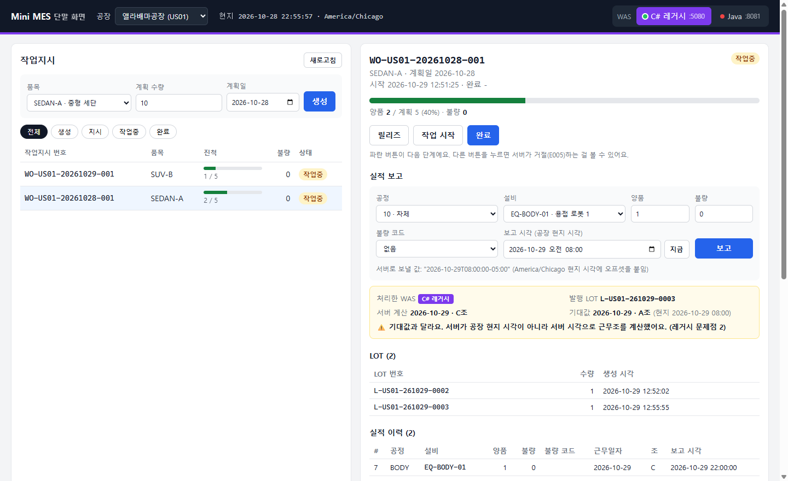

# Mini MES: C# → Java 전환 프로젝트

완성차 공장의 MES(제조실행시스템)를 작게 만들고, **C# 레거시 WAS를 Java(Spring Boot)로 전환**하는 과정을 직접 해 보는 학습 프로젝트입니다.
같은 단말 화면이 두 WAS에서 똑같이 동작하는지 눈으로 확인하면서 진행합니다.



> 앨라배마 공장에서 현지 시각 08:00에 보고한 실적을 레거시 WAS가 C조로 계산한 모습입니다. 기대값은 A조입니다. ([레거시 문제점 2](docs/01-legacy.md#근무조를-서버-시간으로-계산하는-문제))

## 왜 만드나

완성차 MES 백엔드 직무에서 하는 일을 작은 규모로 경험해 보려고 합니다.

| 직무에서 하는 일 | 이 프로젝트에서 하는 것 |
|---|---|
| 기존 서비스의 개발 언어 전환 (C# → Java) | C# 레거시 API를 같은 API 계약으로 Spring Boot에 재구현 |
| MSA, 3-Tier 아키텍처 반영 | WEB(nginx·화면) – WAS – DB 3-tier 구성, WAS 내부 계층(Controller / Service / Mapper) 분리, 이후 서비스 분리 |
| 그룹표준 MES Framework | 공통 응답·예외·공장 컨텍스트를 `mes-common` 모듈로 분리 |
| 서버/단말 데이터 인터페이스 (Socket, REST, EAI) | 가짜 PLC 시뮬레이터 → TCP 게이트웨이 → 실적 반영 |
| 해외 공장 전개 | 공장 코드·시간대 기반 근무조/근무일자 계산 |
| SQL 튜닝, 성능점검 | 대용량 실적 데이터 집계 쿼리 `EXPLAIN ANALYZE` 전후 비교 |
| CI/CD | GitLab CI 스타일 파이프라인, Docker 이미지 |

## 구조

```
[WEB tier]                        [WAS tier]                          [DB tier]
단말 화면 ─▶ nginx :3000 ─┬─ /legacy → C# 레거시 :5080 ─┐
                          └─ /java   → Java      :8081 ─┴─▶ PostgreSQL :55432
```

- 화면은 어느 WAS가 응답하는지 모릅니다. 요청 주소의 앞부분(`/legacy`, `/java`)만 바뀌고, nginx가 해당 WAS로 넘깁니다.
- 두 WAS는 같은 DB를 쓰고 같은 응답 계약을 지킵니다. 그래서 화면 코드는 바꾸지 않아도 됩니다.
- **Tier**는 따로 실행·배포되는 단위(화면, WAS, DB)이고, **Layer**는 WAS 코드 안의 역할 구분(Controller / Service / Mapper)입니다.

| 폴더 | 역할 |
|---|---|
| [`web/`](web/) | WEB tier: 단말 화면(HTML/JS) + nginx |
| [`legacy-csharp/`](legacy-csharp/) | WAS tier: 전환 대상 C# 레거시 |
| `mes-api/` | WAS tier: 전환 결과 Java (2단계) |
| [`db/`](db/) | DB tier: 스키마, 기초 데이터 |

## 도메인

- **기준정보**: 공장, 품목, 공정(차체 → 도장 → 의장 → 검사), 라우팅, 설비, 불량 코드
- **작업지시**: `CREATED → RELEASED → IN_PROGRESS → COMPLETED`
- **생산실적**: 양품/불량 보고, LOT 발행, 근무조(A 06~14, B 14~22, C 22~06) 계산, 계획 수량 도달 시 자동 완료
- **공장**: 울산(KR01, Asia/Seoul), 앨라배마(US01, America/Chicago), 체코(CZ01, Europe/Prague)

## 핵심 결정

- **화면과 DB는 그대로, WAS만 전환한다.** 문제가 생겼을 때 원인 범위를 좁히기 위해서입니다.
- **API 응답 계약을 유지한다.** HTTP 200 + `resultCode`, snake_case 키까지 그대로 맞춥니다. 단말 화면이 이 형식에 의존하기 때문입니다.
- **옮기기와 고치기를 나눈다.** 레거시 동작을 그대로 옮기고 동등성을 확인한 다음, 동작이 바뀌는 수정(공장 시간대, 채번)을 따로 적용합니다.

## 진행 상황

단계별 설계 이유와 과정은 [`docs/`](docs/)에 정리합니다.

- [x] **1단계: C# 레거시 API** — [설명](docs/01-legacy.md) · [코드](legacy-csharp/)
- [x] **단말 화면 (WEB tier)** — [설명](web/README.md) · [코드](web/)
- [ ] 2단계: Spring Boot 전환 (API 계약 유지, WAS 내부 계층 분리)
- [ ] 3단계: 동등성 검증 (같은 시나리오를 C#/Java 양쪽에 실행해 결과 비교)
- [ ] 4단계: 설비 TCP 인터페이스 + PLC 시뮬레이터
- [ ] 5단계: 해외 공장 시간대 처리 (레거시 버그 수정)
- [ ] 6단계: SQL 튜닝
- [ ] 7단계: CI/CD, 컨테이너 배포

## 실행

```bash
docker compose up -d                          # PostgreSQL(:55432) + nginx 화면(:3000)
cd legacy-csharp/LegacyMes && dotnet run      # C# 레거시 WAS(:5080)
```

브라우저에서 http://localhost:3000 을 엽니다. 모듈별 자세한 내용은 각 폴더의 README를 참고하세요.

## 기술 스택

- WEB: nginx / HTML·CSS·JavaScript (빌드 도구 없음)
- Legacy WAS: C# / .NET 8 / ASP.NET Core / Npgsql
- Target WAS: Java 17 / Spring Boot 4 / MyBatis
- DB: PostgreSQL 16
